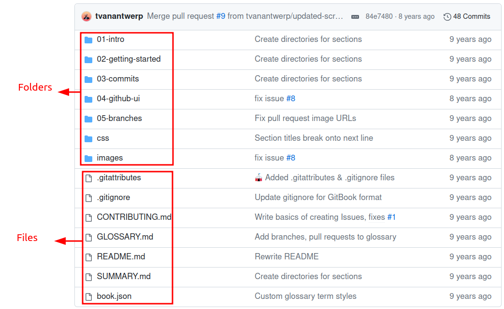
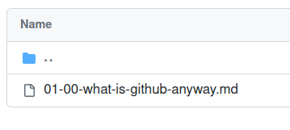
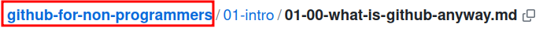

# GitHub for Non-Programmers

GitHub is a website designed for programmers to collaboratively build their code. But that doesn't mean you need to be a programmer to use it! You can get started with collaborative version-tracking of your (non-programming) work without ever writing a line of code or using the command line.

## A Guide for People Who Don't Code and Don't Want to Code.

If you're unsure whether or not GitHub is something you want to try, I can understand. Learning new things is mentally taxing. So let me promise you now: once you've gone through this guide and given the GitHub workflow a try, you'll never want to go back to the way it was before. Why is that? Because the GitHub workflow is surprisingly simple and sane. You're going to eliminate a lot of problems that are *already* taxing your brain, such as "Which version of this file was the final one?" and "Who is responsible for making this edit?" Trust me, you're going to like this once you get into it.

This guide isn't meant to turn someone into a `git` master. It should show non-programmers a simple way to add `git` and GitHub to their work process with a minimum of jargon. This guide will contain no code, and it will only show how to use the GitHub desktop app for simplicity's sake.

You probably don't write code, and may never want to write code. You are happy with the subpar version control you have (e.g., `file.docx`, `file final.docx`, `file FINAL.docx`, etc.), not because it's good, but because you haven't been shown any other way to do it. This guide is an attempt to show you that better way without making your brain explode.

## How to Start

At the top of this repository page is the "navigation pane" that shows all the folders and files. Think of it as navigating your own computer's folders and files in Windows File Explorer or Mac Finder.

Start by clicking the folder named `01-intro`.

Inside, you will see a file named `01-00-what-is-github-anyway.md`. Click this file to begin reading.

Once you're done, navigate back to the main repository page by going to the top of the page and clicking `github-for-non-programmers`.

Continue the rest of the guide by reading the file(s) inside `02-getting-started`, then the file(s) `03-commits`, and so forth. There is also a handy summary file named `SUMMARY.md` with links to each topic.

## Contributing

Any help is welcome in improving this guide. Please see [our contributing guidelines](https://github.com/tvanantwerp/github-for-non-programmers/blob/master/CONTRIBUTING.md) for ways to help out.

## License

This guide is distributed under a [Creative Commons Attribution-ShareAlike 4.0 International License](https://creativecommons.org/licenses/by-sa/4.0/). Designs in GitHub products are copyrighted by GitHub, and their images are used under fair use doctrine for educational purposes.
